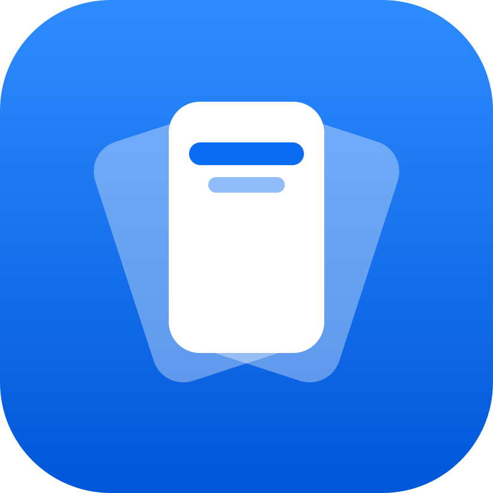
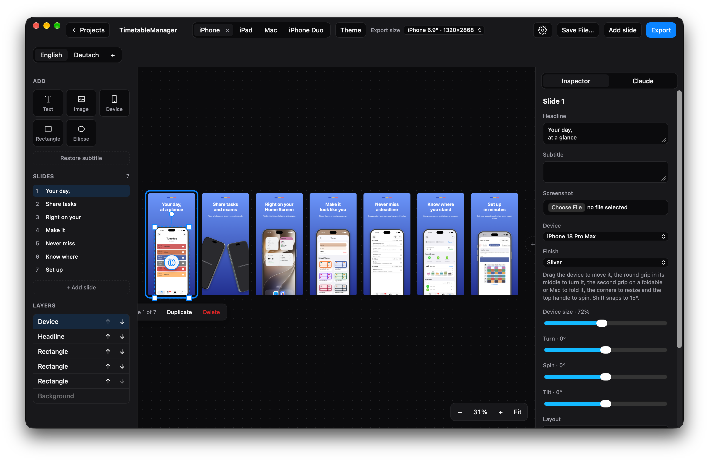
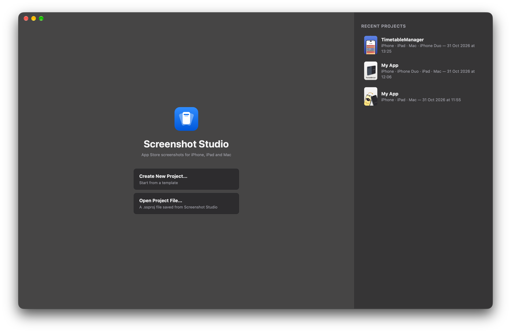
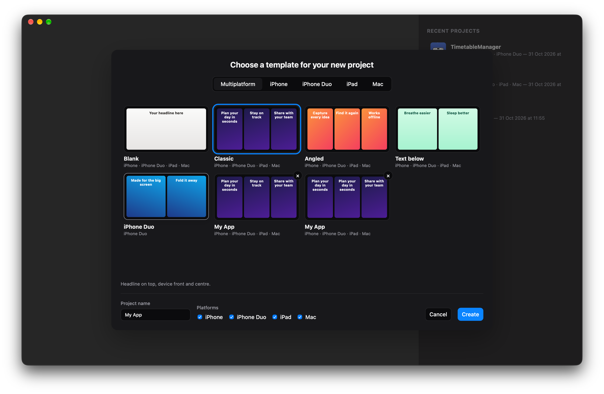

<p align="center">
  
</p>

<h1 align="center">Screenshot Studio</h1>

<p align="center">
  Make App Store screenshots for iPhone, iPad and Mac.
</p>

<p align="center">
  
</p>

<p align="center">
  
  &nbsp;
  
</p>

## Features

- **One project, several platforms**: iPhone, iPad and Mac sets side by side. A new platform starts from an existing one's slides.
- **App Store sizes**: iPhone 6.9", 6.3", 6.5"; iPad 13", 11"; Mac 2880×1800 down to 1280×800.
- **3D device frames** with pose, size and finish controls, including foldables with an outer display.
- **Templates**: built-in designs, plus your own saved from any project (Export → Template), with or without its screenshots. Tick **Share with everyone** and the app opens GitHub's web editor with the template filled in, so you can propose it for `templates/` in this repo.
- **Languages**: add App Store localizations (German, English, Japanese and so on) to a project. Each language has its own headline, subtitle and texts, and can have its own screenshots (a language without one shows the primary language's). Everything else (devices, colors, layout) is shared, so a change shows up in every language.
- **Export** PNGs of the slides and languages you pick. The desktop app writes them all to a folder you pick. Or export one web page that shows them all, with platform and language filters and a click-to-enlarge view.
- **Project files** (`.ssproj`): one JSON file with the screenshots inside, for backup or sharing.
- **AI agent built in** (desktop): a chat panel that runs an AI agent connected to the app. It can see and change everything in the open project while you watch. It can also search the web for images (icons, logos, photos) and download them onto slides. Click any tool call in the chat to see what it sent and what came back.
- **Images and SVGs**: PNG, JPEG, WebP and SVG work as screenshots and as images on slides. SVGs stay sharp at any export size.

## MCP

The desktop app runs an MCP server (streamable HTTP) at `http://127.0.0.1:7457/mcp` while it's open, so any MCP client can work on the live project: Claude Code, Codex, Gemini CLI, Cursor, VS Code and others. Its tools: `get_state`, `update_project`, `render_slide` (the agent sees the slide as it exports), `export_pngs`, `save_project_file`, `update_screenshots`, `create_project`, `open_project`, `close_project` and `delete_project`.

- **In the app**: open the **Agent** tab next to the Inspector in the editor sidebar. For now the panel runs [Claude Code](https://claude.com/claude-code) (`claude -p`) through your login shell, so that needs to be installed and logged in.
- **From any MCP client**: connect it once (Settings shows these too), then ask it to work on your screenshots:

  ```sh
  claude mcp add --scope user --transport http screenshot-studio http://127.0.0.1:7457/mcp
  codex mcp add screenshot-studio --url http://127.0.0.1:7457/mcp
  gemini mcp add --scope user --transport http screenshot-studio http://127.0.0.1:7457/mcp
  code --add-mcp '{"name":"screenshot-studio","type":"http","url":"http://127.0.0.1:7457/mcp"}'
  ```

  Clients configured by JSON (Cursor's `~/.cursor/mcp.json`, Windsurf, Zed…) take this entry:

  ```json
  { "mcpServers": { "screenshot-studio": { "type": "http", "url": "http://127.0.0.1:7457/mcp" } } }
  ```

- **From the terminal**: the app itself is a command line for the same tools, for scripts and automations. It starts the app if it isn't running. On macOS, put it on your PATH once:

  ```sh
  ln -s "/Applications/Screenshot Studio.app/Contents/MacOS/app" /usr/local/bin/screenshot-studio

  screenshot-studio tools                                  # list tools and their arguments
  screenshot-studio render_slide platform=iphone index=0   # saves render_slide-1.png
  screenshot-studio export TrackStar out iphone            # PNGs of a saved project by name; platform optional
  screenshot-studio export TrackStar TrackStar.ssproj      # the project file
  screenshot-studio replace_screenshots '{"screenshots":{"home":"/tmp/home.png"}}'
  screenshot-studio update_screenshots                     # apply every project's screenshot folder; prints what changed
  ```

The server only listens on localhost and refuses requests from web pages (any request with an `Origin` header). Its tools can read screenshots from, and export PNGs to, anything under your home folder, `/tmp` and `/Volumes`.

## Getting started

Requirements: Node.js and [pnpm](https://pnpm.io). The desktop app also needs Rust (the stable toolchain is pinned in `src-tauri/rust-toolchain.toml`) and the [Tauri prerequisites](https://tauri.app/start/prerequisites/).

```sh
pnpm install

pnpm dev            # browser version at http://localhost:5173
pnpm desktop        # desktop app in development mode
pnpm desktop:build  # bundled app in src-tauri/target/release/bundle/
```

Other scripts: `pnpm build` (type check plus production web build into `dist/`) and `pnpm lint` (oxlint).

## Where data is stored

| | Projects | Saved templates |
|---|---|---|
| Desktop app | `<app data>/projects/<id>/`, which holds `project.json` and one image file per screenshot | `<app data>/templates.json` |
| Browser | IndexedDB (`screenshot-studio`) | localStorage |

`<app data>` is the app's data folder for the identifier `app.screenshotstudio.desktop`:

- macOS: `~/Library/Application Support/app.screenshotstudio.desktop`
- Windows: `%APPDATA%\app.screenshotstudio.desktop`
- Linux: `~/.local/share/app.screenshotstudio.desktop`

## Project layout

```
src/
  main.tsx, App.tsx    entry; start page or editor, autosave
  start/               start page, template gallery, opening a project file
  editor/              the editor: board, slide canvas, inspector, palette, themes, language dialog, undo history
  export/              export dialog (PNGs, templates) and the exported website
  agent/               MCP tools (tools.ts), answering requests the Rust side forwards (agent.ts), and the agent chat
  settings/            app settings and the MCP setup; prefs.ts: preferences kept in localStorage
  model/               projects and storage, slides and their elements, the draw function shared by preview and
                       export, templates and themes, Open Screenshot Generator import, the screenshot folder
  devices/             device models and the 3D frame renderer (three.js)
  lib/                 where browser and desktop differ (native.ts); animated view transitions (motion.ts)
  builtin/             built-in templates, themes and filler screenshots
src-tauri/             Tauri desktop shell; src/lib.rs has the MCP HTTP server and runs the agent CLI, src/cli.rs the command line
scripts/               bump and release, Apple signing secrets, Open Screenshot Generator conversion
```

## License

[MIT](LICENSE)
